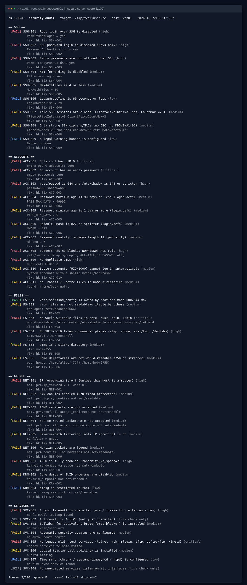
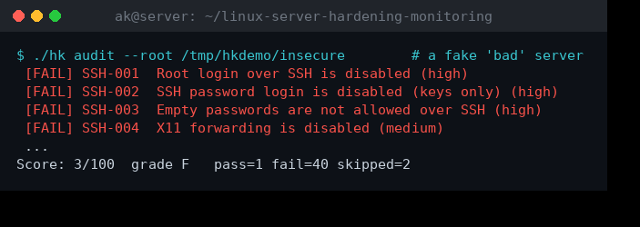
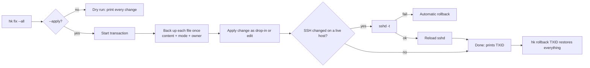
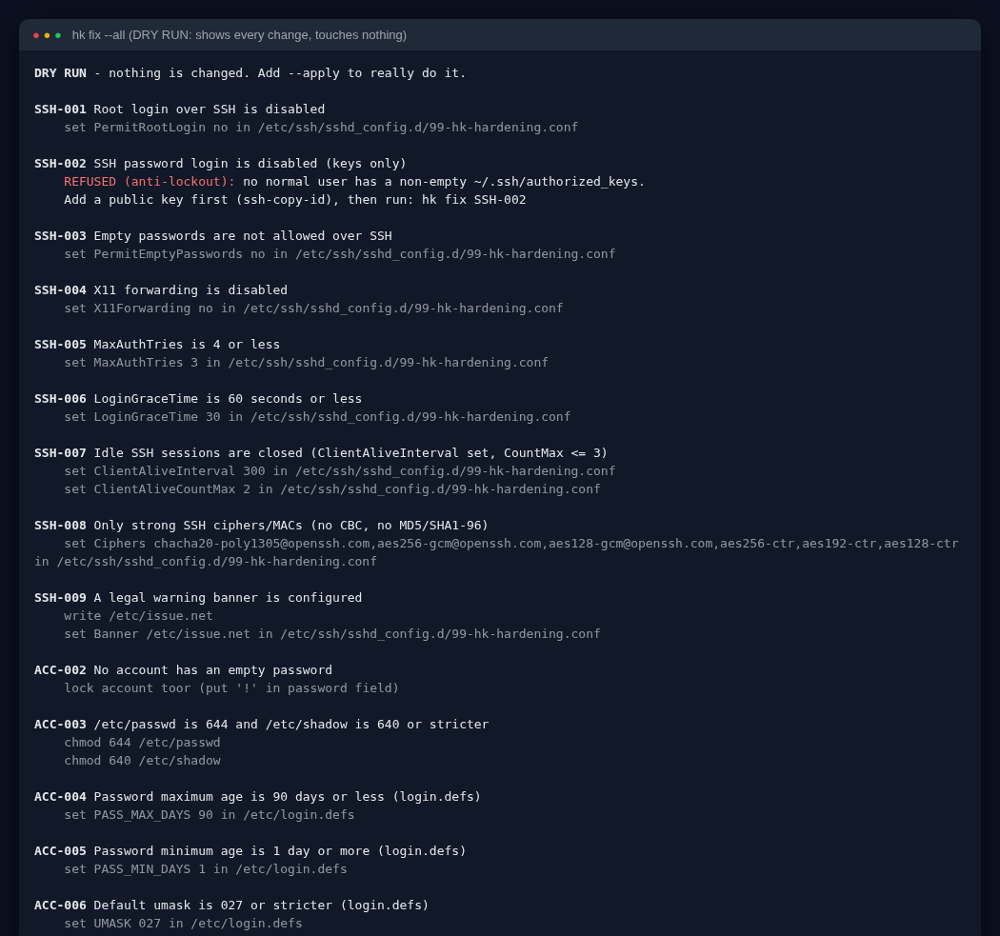
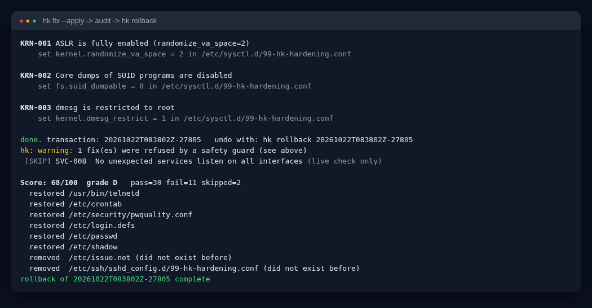
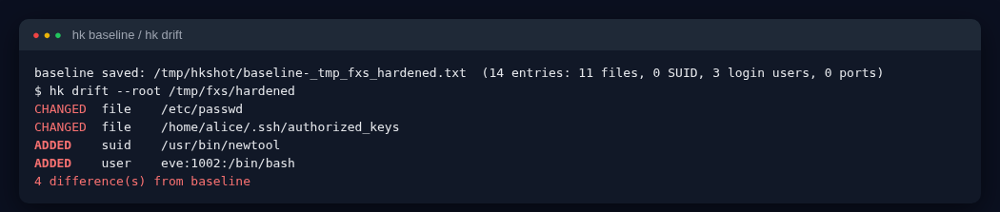
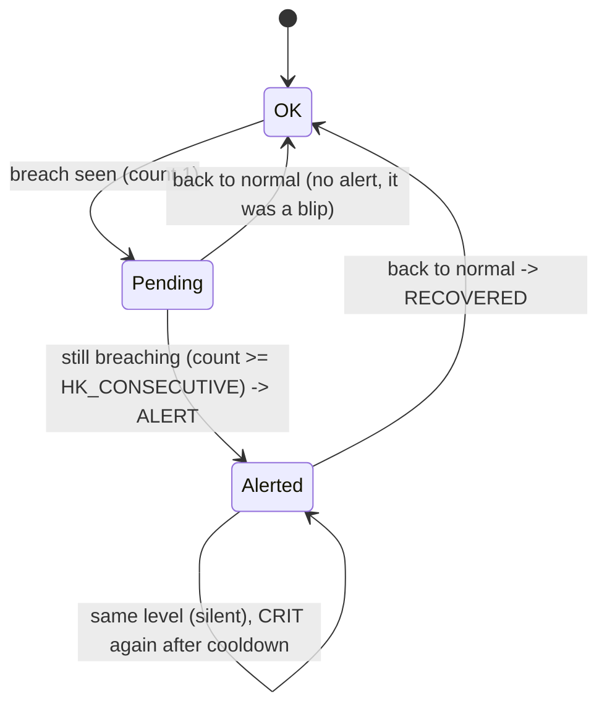
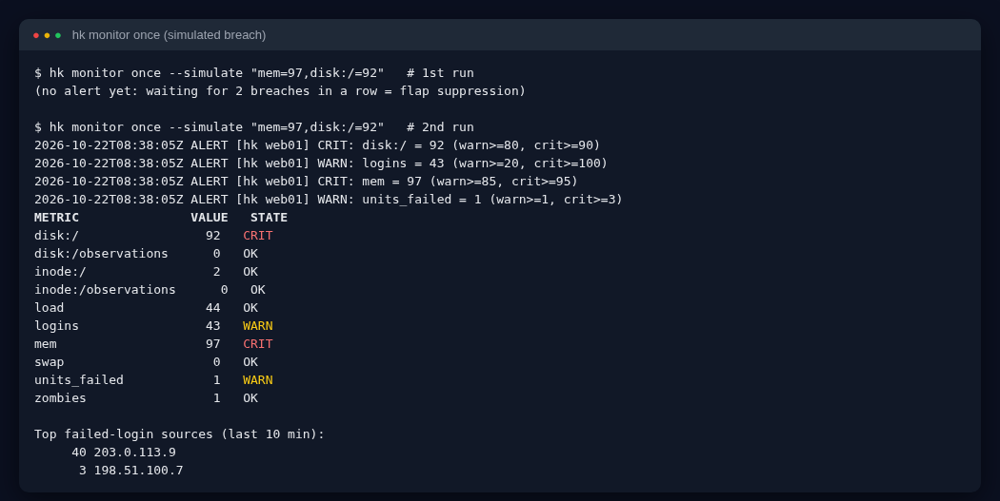
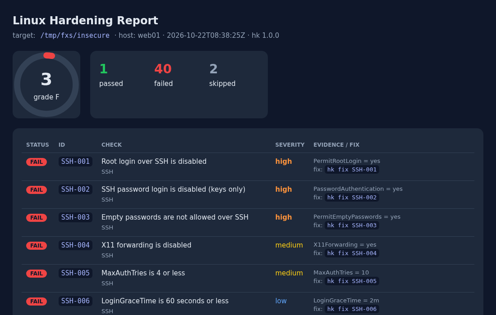

# Linux Server Hardening + Monitoring Toolkit (`hk`)

[](https://github.com/AKASH991833/linux-server-hardening-monitoring/actions/workflows/ci.yml)
[](https://github.com/AKASH991833/linux-server-hardening-monitoring/releases)
  

One command-line tool (`hk`) that **audits** a Linux server against 43 security checks, **fixes** problems safely (with a dry-run first, an anti-lockout guard, and one-command **rollback**), **detects drift** from a known-good state, and **monitors** health with smart alerts. Pure Bash. No dependencies. Runs on Ubuntu, Debian, RHEL, Rocky, Alma.



**20-second demo** (real output: audit a bad server, fix it, re-audit, roll back):



## What makes this different from a normal "hardening script"

| Feature | What it means for you |
|---|---|
| **Offline audit** (`--root DIR`) | Audit a *mounted disk image, backup or container filesystem* without booting it. Perfect for checking a VM image before you deploy it. Also how the test-suite runs without root. |
| **Transactional fixes + rollback** | Every file hk changes is saved first. `hk rollback <id>` puts back the exact content, permissions and owner. Tested: the system after rollback is byte-identical to before. |
| **Anti-lockout guard** | hk refuses to disable SSH passwords unless a normal user already has an `authorized_keys` entry. It validates `sshd -t` before reloading and auto-rolls back if sshd rejects the config. You cannot lock yourself out by accident. |
| **Drop-in files, not edits** | SSH and sysctl fixes go in `99-hk-hardening.conf` drop-ins. Vendor config stays untouched, so package upgrades never fight you. |
| **Drift detection** | `hk baseline create` remembers hashes of critical files, the SUID list, login users and open ports. `hk drift` tells you exactly what changed (a new SUID binary, a changed `authorized_keys`, a new user...). |
| **Flap-suppressed alerts** | The monitor alerts only after N breaches in a row, never repeats while the state is unchanged, re-reminds only for CRITICAL after a cooldown, and sends a RECOVERED message. No alert spam. |
| **Brute-force view** | Counts failed SSH logins in a time window and shows the top attacker IPs. |
| **Prometheus export** | Writes `hk.prom` in node_exporter *textfile* format. Grafana-ready. |
| **Score + trend** | 0-100 weighted score (critical=10, high=6, medium=3, low=1) with grade A-F, JSON for CI/CD, and a self-contained HTML report with a score trend line. |

> Preparing for an interview? Read [INTERVIEW.md](INTERVIEW.md) (60-second pitch, design choices, 10 Q&A).

## Quick start (60 seconds to your first score)

```bash
git clone https://github.com/AKASH991833/linux-server-hardening-monitoring.git
cd linux-server-hardening-monitoring

sudo ./hk audit                 # 1. see the score and what is wrong
sudo ./hk fix --all             # 2. DRY RUN: shows every change, touches nothing
sudo ./hk fix --apply --all     # 3. really apply (prints a transaction id)
sudo ./hk rollback <txid>       # 4. changed your mind? undo everything
```

Try it safely with **no root and no risk** using the built-in fixtures:

```bash
tests/make-fixtures.sh /tmp/fx
./hk audit --root /tmp/fx/insecure          # score 3/100
./hk fix --apply --root /tmp/fx/insecure --all
./hk audit --root /tmp/fx/insecure          # much better
```

## Learn it from zero: every topic explained

You do not need prior knowledge. Each section says **what it is**, **why it matters**, and **how hk handles it**.

### 1. Why harden a server at all?
A freshly installed server is configured for *convenience*: root can log in, passwords are accepted, many ports are open. Attackers scan the internet all day for exactly this. Hardening means removing the convenience that attackers use. Almost every real breach starts with one of: weak SSH, weak passwords, an exposed service, a missing update.

### 2. SSH hardening (checks `SSH-001` to `SSH-009`)
SSH is the front door. hk checks:
- **PermitRootLogin** `no`: nobody should log in directly as root. Log in as a user, then `sudo`. That also gives you an audit trail of *who* did what.
- **PasswordAuthentication** `no`: passwords can be guessed by bots. SSH *keys* cannot. (Guarded by the anti-lockout rule.)
- **PermitEmptyPasswords**, **X11Forwarding**, **MaxAuthTries**, **LoginGraceTime**, **ClientAliveInterval**: close small doors (empty passwords, GUI forwarding, unlimited guesses, hanging half-open logins, forgotten idle sessions).
- **Ciphers/MACs**: old algorithms (CBC, 3DES, MD5) are breakable. Modern OpenSSH defaults are fine; hk flags only if someone *explicitly* enabled weak ones.
- **Banner**: a legal "authorized use only" notice.

How hk reads sshd config the way sshd does: *first value wins*, `Include` files are expanded in place, and `Match` blocks are ignored for the global value.

### 3. Accounts and passwords (`ACC-001` to `ACC-011`)
- **Only root has UID 0.** UID 0 *is* root. A second UID-0 account is a classic backdoor.
- **No empty passwords.** `hk fix ACC-002` locks such accounts (`!` in `/etc/shadow`).
- **File permissions of `/etc/passwd` (644) and `/etc/shadow` (640).** Shadow holds password hashes; if readable by everyone, attackers crack them offline.
- **Password aging** (`PASS_MAX_DAYS 90`, `PASS_MIN_DAYS 1`) and **umask 027** (new files are not world-readable).
- **Password quality** (`minlen 12` in `pwquality.conf`).
- **sudoers**: a blanket `NOPASSWD: ALL` means anyone who gets that user's session owns the machine.
- **System accounts** (`mysql`, `daemon`...) should have `/usr/sbin/nologin` as shell.
- **`.rhosts` / `.netrc`**: legacy files that store trust or plain-text passwords.

### 4. Files and permissions (`FS-001` to `FS-006`)
Linux permissions are `rwx` for owner/group/others, written as numbers (`644` = owner read-write, everybody else read). hk looks for: world-writable system files (anyone could replace a binary), **SUID/SGID** files in `/tmp` or `/home` (a SUID root file lets any user run it as root; a classic privilege-escalation trick), missing **sticky bit** on `/tmp` (users could delete each other's files), and open home directories.

### 5. Kernel and network parameters (`NET-*`, `KRN-*`)
`sysctl` settings change how the kernel behaves: `ip_forward=0` (do not act as a router), `tcp_syncookies=1` (survive SYN floods), no ICMP redirects or source routing (stop traffic hijacking), `rp_filter=1` (drop spoofed source IPs), `randomize_va_space=2` (full ASLR makes memory exploits harder), `suid_dumpable=0`, `dmesg_restrict=1`. On a live system hk asks the kernel; offline it reads `sysctl.conf` and `sysctl.d/`.

### 6. Services, firewall, updates, logging (`SVC-001` to `SVC-008`)
Firewall installed **and active**, **fail2ban** (bans IPs after repeated failures), **unattended security updates**, no **telnet/rsh/ftp/tftp/xinetd**, **auditd**, **time sync** (logs and TLS need a correct clock), and "only expected ports listen on all interfaces" (`HK_ALLOWED_PORTS`).

### 7. Safe fixing: dry-run, transactions, rollback




### 8. Drift detection
A "baseline" is a snapshot of what you trust today. Later `hk drift` compares and prints `CHANGED` / `ADDED` / `REMOVED`. Run it from cron; any output is worth reading (for example a new SUID binary after an intrusion).


### 9. Monitoring and alerts

Metrics: CPU load (% of cores), memory, swap, disk % and inode % per filesystem, zombie processes, failed systemd units, failed SSH logins. Channels: `log`, `stdout`, `webhook` (Slack/Discord/n8n), `telegram`, `mail`. Secrets (Telegram token) are read from a root-only file, never from the config or git.


Install it as a timer (prints the units; add `--apply` to install):
```bash
./hk monitor install --systemd        # or --cron
```
Test your alerting any time without breaking anything: `hk monitor once --simulate "mem=97,disk:/=92"`.

### 10. Reports
```bash
./hk audit --format all --out ./report   # report.txt, report.json, report.html, results.tsv
./hk audit --format json --min-score 80  # exit code 1 if score < 80 => use as a CI/CD gate
```


### Storage and cron checks (v1.3.0)
| ID | What it checks | Fix |
|---|---|---|
| STO-001 | `/etc/fstab` lines parse and devices exist | report |
| STO-002 | secondary mounts have `nofail` (a missing disk must not block boot) | `hk fix` |
| STO-003 | md RAID complete, not inactive/degraded (live only) | report |
| STO-004 | LVM VG free space, snapshot and thin-pool fullness (live only) | report |
| CRN-001 | scripts run by system cron are not world-writable | `hk fix`, rollback supported |
| CRN-002 | root cron does not run from /tmp or pipe `curl` into a shell | report |
| CRN-003 | `/etc/cron.allow` exists | `hk fix` |
`hk monitor` also alerts on RAID degraded/failed, VG usage, snapshot fullness and thin-pool data/metadata, and sends a RECOVERED notice when it clears.

## Command reference

| Command | What it does |
|---|---|
| `hk audit [--root DIR] [--format text\|json\|html\|all] [--out DIR] [--category SSH\|ACCOUNTS\|FILES\|KERNEL\|SERVICES] [--only ID,ID] [--min-score N]` | run checks |
| `hk checks` | list all 43 checks |
| `hk fix [--apply] [--root DIR] (--all \| ID ...)` | dry-run (default) or apply fixes |
| `hk tx list` / `hk rollback TXID` | list / undo fix transactions |
| `hk baseline create` / `hk drift` | snapshot and compare |
| `hk monitor once [--simulate ...]` | one monitoring round (exit 0 ok, 1 warn, 2 critical) |
| `hk monitor install [--systemd\|--cron] [--apply]` | schedule monitoring |
| `hk monitor attackers` | top failed-login IPs |

Config: copy `config/hk.conf.example` to `/etc/hk/hk.conf`. State lives in `/var/lib/hk` (or `~/.local/state/hk` when not root; override with `HK_STATE`).

## Project layout
```
hk                  main command
lib/                common helpers, transactions, reports, baseline, monitor
checks/             one file per area; each check = 1 register line + chk_ + optional fix_ function
tests/run.sh        37 automated tests (offline fixtures + mock alert servers)
tests/make-fixtures.sh   builds the "insecure" and "hardened" fake servers
.github/workflows/ci.yml shellcheck + tests + a real-root job on an Ubuntu VM + the suite and a live audit across the RHEL family (Rocky 9, AlmaLinux 9, CentOS Stream 9, Fedora, Red Hat UBI 9) and on Debian 12 and 13
INTERVIEW.md        how to explain this project in a job interview (pitch, design choices, 10 Q&A)
CHANGELOG.md        release history
```
Add your own check in 5 lines:
```bash
register MYORG-001 medium FILES "Company banner exists"
chk_MYORG_001() { [[ -s $(rp /etc/motd) ]]; DETAIL="motd checked"; }
fix_MYORG_001() { fx_write "$(rp /etc/motd)" <<< "Authorized use only"; }
```

## Honest test report
- 37 automated tests pass locally (`tests/run.sh`): audit scoring, JSON validity, SSH first-match/Match handling, dry-run changes nothing, anti-lockout, apply, **rollback is byte-identical**, drift (changed key, new SUID, new user), monitor flap suppression, cooldown, recovery, Prometheus output, systemd unit generation, and **delivery of webhook, Telegram and mail alerts to local mock servers** (payloads verified).
- ShellCheck clean (`-S error`).
- **Tested offline against fixtures and on a live non-root sandbox** (audit + monitor). The *live root* path (`sudo hk fix --apply`, `sshd -t`, `sysctl --system`, real `systemctl`) is exercised by the `live-root` job in GitHub Actions on a real Ubuntu VM; see the CI badge.
- **CI result (Oct 22, 2026):** both jobs green on a real Ubuntu VM. The live-root run found and fixed 3 real bugs (a missing /run/sshd made the sshd check roll everything back, rollback did not restore live kernel values, and a very large world-writable file set made fix too slow, so it is now capped at 200 files per run).
- **RHEL-family verified:** the `rhel-family` CI matrix runs the full suite plus a live audit on Rocky 9, AlmaLinux 9, CentOS Stream 9, Fedora (latest) and Red Hat UBI 9 (the free official Red Hat build - no RHEL subscription claimed). Live fix/rollback is verified on Ubuntu (the `live-root` job).
- **Debian verified:** the `debian` CI matrix runs the full suite plus a live audit on Debian 12 (bookworm) and Debian 13 (trixie).
- **Failure drills (live-root job, every push):** a real ext4 filesystem on a loop device is filled past 90% and the monitor must raise `CRIT: disk:` (and stay quiet after cleanup), and a hand-broken sshd drop-in must make `hk fix` validate, refuse, and auto-roll back, leaving sshd healthy.
- Webhook, Telegram and mail channels are covered by mock-server tests; they were not sent to real external accounts.
- Not a replacement for a full CIS benchmark scanner (OpenSCAP, Lynis). It is a small, readable, safe starting point you can understand end to end.

**v1.3.0 storage tests:** fixtures (hardened = pass, insecure = fail) in `tests/run.sh`; real drills in `tests/storage-live.sh` as root on loop devices. Ubuntu runner and Debian 12 container: everything passes (14 checks: md RAID, LVM snapshot overflow, full VG, cron hygiene + fix/rollback). Debian 13, Rocky 9, Alma 9, CentOS Stream 9, Fedora containers: RAID and cron drills run for real (9 checks); LVM drills are skipped because device-mapper is not usable in those containers (the drill prints a NOTE) - real LVM is **not verified** on those distros. UBI 9: fixtures only.

## Safety notes
Run `hk fix` without `--apply` first. Keep a second SSH session open when changing SSH settings. hk never touches firewall rules, never restarts services other than reloading sshd after a validated config, and never edits files outside the list in the dry-run output.

## License
MIT


## Enterprise v2 learning modules

Start at [LEARN.md](LEARN.md). Native builds and installation instructions: [packaging/LEARN.md](packaging/LEARN.md).

The shared enterprise hub is [linux-server-hardening-monitoring](https://github.com/AKASH991833/linux-server-hardening-monitoring):
- `compliance/`: all 50 hk checks accounted for, with 10 verified related/partial mappings to the actual CIS Ubuntu 22.04 LTS v2.0.0 PDF; the rest are explicitly unmapped. No CIS certification and no claim that Ubuntu IDs apply to Debian/RHEL.
- `ansible/`: selected plan-first hk hardening, rolling multi-host playbook, rootfs and live-VM idempotence tests. Not full CIS or webstack deployment.
- `monitoring/`: non-root read-only exporter, Prometheus rules with firing/recovery tests, provisioned Grafana dashboard, localhost-only Compose demo. Container metrics are not full host metrics. No notification receiver is configured.
- `incidents/`: harmless filesystem/log simulation with generated timeline and evidence, detection, containment, rollback and eradication. This is not a real exploit or production incident.

Each repository has .deb/.rpm build/install/remove CI. The Pages publication workflow builds signed APT/RPM metadata and tests installs through the repository before deployment. Keys rotate each publication and expire in 30 days; RPM package headers are unsigned. This is a learning channel, not unattended production updates. See packaging/LEARN.md before trusting/installing anything.

Tests distinguish fixtures from real services and kernel work. v1.3 storage limits still apply: real LVM is verified only on the Ubuntu runner and Debian 12, not every container. A green package install does not verify every workload command. CI artifacts hold generated incident reports and Grafana screenshots.
